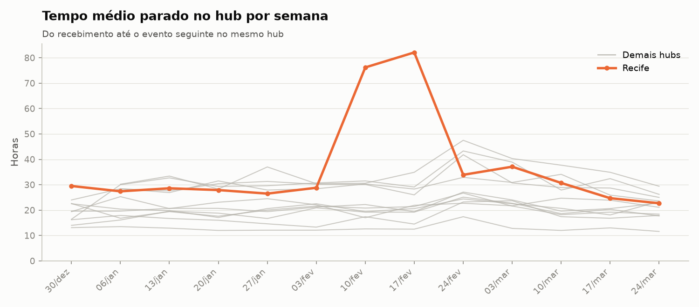
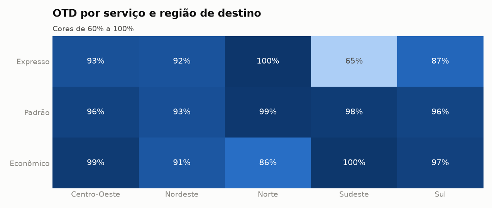
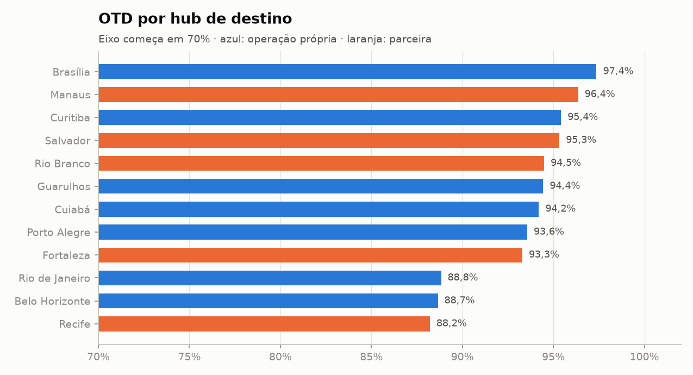
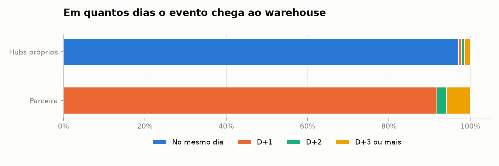

# 05 · Logistics + SQL

Data warehouse de rastreio de encomendas com **carga incremental**, em Python, Pandas e **SQL**.

Neste projeto o Pandas só limpa e carrega. O modelo, as transformações, as análises e os
testes de qualidade ficam em arquivos `.sql`.

```text
data/raw/dt=2025-01-02/                                     data/warehouse/logistica.db
  remessas.csv                 ─┐                            ┌ dim_data, dim_hub, dim_cliente, dim_sla
  eventos_proprios.jsonl.gz    ─┼─ lotes pendentes ─ limpeza ─┤ remessa · fato_evento · fato_entrega
  eventos_parceiro.csv.gz      ─┘   (hash)         (UTC)      └ etl_lote · quarentena
                                                                    │
                                 11 testes em SQL ─ 12 análises em SQL ─ relatório · 16 CSVs · 6 gráficos
```

**Nível:** 3–4 (pipeline com banco, modelagem dimensional, processamento incremental) · **Stack:** Python 3.11+, Pandas, SQLite, SQL, Matplotlib, pytest

---

## Problema e contexto

A **Rota Sul Encomendas** opera 12 hubs em 5 fusos horários. O Norte e o Nordeste são atendidos
por uma transportadora parceira. Todo dia chega um novo lote de dados, e a operação precisa saber:

- Qual a taxa de entregas no prazo (OTD), por serviço, região e hub?
- Onde as remessas ficam paradas, e quando?
- Quantas remessas estão em aberto e quais precisam de investigação?
- Dá para confiar no dado que chega da parceira?

Os dados têm os problemas típicos de eventos que chegam de sistemas distribuídos:

| Problema | Exemplo | Como o pipeline resolve |
|---|---|---|
| Lote diário | 89 partições `dt=AAAA-MM-DD` | Processa só o que falta, comparando o hash dos arquivos com `etl_lote` |
| Evento atrasado | Evento aparece no lote de dias depois | A fato de entrega é reconstruída com **todos** os eventos da remessa, então o atraso só corrige os marcos |
| Evento duplicado entre lotes | Reenvio do mesmo evento | Chave primária + `INSERT OR IGNORE`; a parceira não manda id, então o id é o hash do conteúdo |
| Evento órfão | Evento chega antes da remessa | Fica em `fato_evento`; quando a remessa chega, o lote a recalcula. Não sobra nenhum no fim |
| Remessa reenviada | Peso corrigido na balança | Upsert: só uma versão igual ou mais nova substitui a atual |
| Fusos diferentes | `2025-02-11T02:30:00Z`, `...-03:00`, `10/02/2025 22:00` sem fuso | Tudo vira UTC, e a data **local** de cada evento é guardada à parte |
| Códigos diferentes | `ENTREGUE` nos hubs próprios, `dlv` na parceira | De-para na limpeza |
| Relógio errado, hub desconhecido | Ano 2035, 1970; `SA0`, `XXX` | Quarentena com motivo |
| Peso inválido | `0`, `9999`, `-1` | Vira nulo, sem invalidar a remessa |

## Origem dos dados

Dados **sintéticos** gerados por [`scripts/generate_data.py`](scripts/generate_data.py), com semente fixa. O gerador simula a viagem real de 7.682 remessas pela rede de hubs (jan–mar/2025): trânsito por par de regiões, tempo parado nos hubs, tentativas de entrega, extravios e devoluções.

Duas situações foram plantadas para a análise encontrar: **um congestionamento em Recife** entre 10 e 24 de fevereiro e o **efeito do Carnaval**.

O gabarito em `data/external/` guarda o desfecho real de cada remessa e é usado só para medir o resultado.

> Empresas e dados são fictícios.

## Modelagem

Esquema estrela em [`sql/schema/01_warehouse.sql`](sql/schema/01_warehouse.sql):

| Tabela | Grão | Papel |
|---|---|---|
| `fato_evento` | 1 evento de rastreio | Fato transacional: nunca muda, só recebe linhas novas |
| `fato_entrega` | 1 remessa | **Accumulating snapshot**: a mesma linha é atualizada a cada marco (coleta, chegada, saída, entrega) |
| `dim_data` | 1 dia | Dia útil e **sequência de dias úteis** |
| `dim_hub` | 1 hub | Região, fuso e operador |
| `dim_cliente` · `dim_sla` | 1 cliente · 1 combinação de serviço e regiões | Cliente e matriz de prazos |
| `remessa` | 1 remessa | Última versão do cadastro |
| `etl_lote` · `quarentena` | 1 lote · 1 rejeição | Controle da carga |

**Prazo em dias úteis sem laço:** a `dim_data` numera os dias úteis, e um dia não útil herda o número do próximo. Somar N dias úteis vira um join: `limite.seq_dia_util = postagem.seq_dia_util + prazo`.

## Decisões de engenharia

| Decisão | Por quê |
|---|---|
| **Uma transação por lote** | Se qualquer passo falha, nada do lote fica no banco e ele continua pendente. |
| Não usar `executescript` nem `to_sql` | Os dois fazem commit sozinhos e quebrariam a atomicidade. `db.py` roda comando a comando e insere com `executemany`. |
| Recalcular só as remessas afetadas | É o que faz a carga ser incremental: o custo depende do lote, não do histórico. |
| Reconstruir a linha da remessa a partir de todos os eventos | Torna o resultado independente da ordem de chegada. Um teste processa os 89 lotes **de trás para frente** e confere que dá o mesmo. |
| Guardar a **data local** do evento | Uma entrega às 22h em Manaus já é o dia seguinte em UTC, e o prazo vale pela data no destino. |
| Lote com arquivo alterado é reprocessado | O hash detecta o reenvio, e os upserts tornam o reprocessamento idempotente. |
| Remessa em aberto vira atrasada sem nenhum evento novo | O tempo passar também muda a situação (`50_atualizar_em_aberto.sql`). |
| **OTD só com prazos vencidos**, e aberto depois do prazo conta como atraso | Sem isso, a primeira versão mostrava abril com 100%: as únicas entregas registradas eram as rápidas (viés de sobrevivência). |
| Testes de qualidade em SQL | Cada arquivo é uma consulta que deve voltar vazia, e o prefixo `critica_` ou `alerta_` define a severidade. É o modelo dos testes do dbt. |

### SQL usado

| Recurso | Onde |
|---|---|
| `ROW_NUMBER`, `COUNT() OVER` com `WINDOW` nomeada | Percentis de lead time, que o SQLite não tem prontos |
| `LAG` / `LEAD` | Variação mensal e tempo parado em cada hub |
| `RANK` / `DENSE_RANK` com `PARTITION BY` | Ranking de hubs e de gargalos |
| `AVG() OVER (ROWS BETWEEN 3 PRECEDING ...)` | Média móvel de 4 semanas e acumulado |
| CTEs encadeadas e agregação condicional | Marcos da fato de entrega |
| `INSERT ... ON CONFLICT DO UPDATE ... WHERE` | Upsert que respeita a versão mais nova |
| Join por intervalo | Backlog diário |

## Arquitetura

```text
05-logistics-sql/
├── main.py                 # --ate AAAA-MM-DD · --reset
├── scripts/generate_data.py
├── sql/
│   ├── schema/             # tabelas
│   ├── transform/          # merges e fato de entrega, executados a cada lote
│   ├── analytics/          # 12 consultas
│   └── tests/              # 11 testes (critica_* e alerta_*)
├── src/
│   ├── db.py               # conexão, scripts e inserts sem commit implícito
│   ├── extract.py          # lotes pendentes (hash), leitura
│   ├── clean.py            # fusos, códigos, quarentena
│   ├── load.py             # transação por lote, dimensões
│   ├── quality.py · analyze.py · evaluate.py
│   └── report.py · visualize.py
├── tests/                  # 19 testes
├── data/raw/dt=*/          # 89 partições
├── data/warehouse/         # banco gerado (fora do git)
└── output/                 # relatorio.md · reports/ (16 CSVs) · charts/ (6 PNGs)
```

## Como executar

```bash
cd 05-logistics-sql
python3 -m venv .venv && source .venv/bin/activate   # Windows: python -m venv .venv && .venv\Scripts\activate
pip install -r requirements.txt
```

Processar tudo o que estiver pendente:

```bash
python main.py
```

Simular a operação diária: carregar até uma data e depois rodar de novo para pegar só o restante:

```bash
python main.py --reset --ate 2025-02-15
```

```bash
python main.py
```

Rodar os testes:

```bash
pytest
```

Para explorar o banco com SQL:

```bash
sqlite3 data/warehouse/logistica.db "SELECT status_atual, COUNT(*) FROM fato_entrega GROUP BY 1"
```

A carga completa leva cerca de 3 segundos; sem lotes novos, menos de 1.

## Resultados obtidos

Relatório completo: [`output/relatorio.md`](output/relatorio.md).

| Indicador | Valor |
|---|---|
| Remessas | 7.682 (7.416 entregues, 198 em trânsito, 48 extraviadas, 20 devolvidas) |
| Entregas no prazo (OTD) | **92,45%** (entre 7.258 prazos já vencidos) |
| Lead time médio | 3,89 dias |
| Remessas com tentativa de entrega falha | 12,7% |
| Frete total | R$ 312,4 mil |

### Gargalos



- **Recife:** o tempo parado no hub salta de 28 para 82 horas nas semanas de 10 e 17 de fevereiro. Remessas para Recife postadas entre 5 e 21 de fevereiro tiveram OTD de **69,6%**. No trimestre, Recife é o pior hub (88,2%).
- **Carnaval:** todos os hubs sobem juntos na semana de 24 de fevereiro.
- **Média mensal esconde o problema:** o OTD de fevereiro quase não mudou (91,9%). O congestionamento de um hub só aparece quando se olha por hub e por semana.

### Prazos

| | |
|---|---|
|  |  |

- **O ponto mais fraco é o expresso dentro do Sudeste: 65%.** O prazo médio ali é de 1,4 dia útil, mas o lead time médio é de 2 dias. É isso que derruba Rio e Belo Horizonte (cerca de 89%). O problema é a promessa de prazo, não a operação, e vale rever a matriz.
- **Parceira x própria:** o OTD é parecido (93,2% e 92,9%), porque os prazos do Norte e do Nordeste são maiores. Mas a parceira tem o dobro de tentativas falhas (20,6% contra 10,0%) e fica mais tempo com a remessa parada: 29 a 37 horas por hub, contra 13 a 23 horas nos hubs próprios.

### Saúde da carga



| Métrica | Valor |
|---|---|
| Lotes processados | 89 |
| Eventos lidos / novos | 59.535 / 58.665 (870 duplicados ignorados) |
| Eventos que chegaram depois do dia em que aconteceram | 10.010 (17%), dos quais 1.772 com 2 dias ou mais |
| Registros em quarentena | 229 (138 hubs desconhecidos, 91 relógios errados) |
| Eventos órfãos no fim da carga | 0 |

**Consequência prática da latência:** a parceira envia em D+1, então o painel de hoje sempre mostra as entregas dela com um dia de atraso.

### Comparação com o gabarito

| Verificação | Resultado |
|---|---|
| Remessas no warehouse | 7.682 de 7.682 |
| Data limite correta | 7.682 de 7.682 |
| Data local de entrega correta | 7.416 de 7.416 |
| Situação de prazo correta | 7.416 de 7.416 |
| Status igual ao real | 7.599 de 7.682 |

As 83 divergências de status têm causa conhecida:
- **56:** o evento final ainda não tinha chegado no último lote.
- **27:** o evento final caiu na quarentena, por relógio errado ou hub desconhecido. Essas remessas foram entregues, mas parecem paradas. O alerta `saiu_para_entrega_sem_desfecho` aponta 28 casos, e a fila completa de 60 remessas sem evento há 3 dias ou mais está em [`remessas_paradas.csv`](output/reports/remessas_paradas.csv).

### Testes da carga incremental

Estas propriedades são verificadas em [`tests/test_load.py`](tests/test_load.py) com os lotes reais:

- rodar de novo não tem o que fazer;
- carregar em duas etapas dá o mesmo resultado que carregar de uma vez;
- processar os lotes em ordem inversa dá o mesmo resultado;
- reprocessar um lote não muda nada;
- um lote com falha não deixa nada no banco.

## Próximas evoluções

- Corrigir eventos da quarentena e reprocessar (ex.: usar o hub de destino da remessa quando o evento final vem com hub inválido).
- Trocar SQLite por PostgreSQL (projeto 07) e a transformação por dbt (projeto 08).
- Agendar a carga diária com Airflow (projeto 10).
