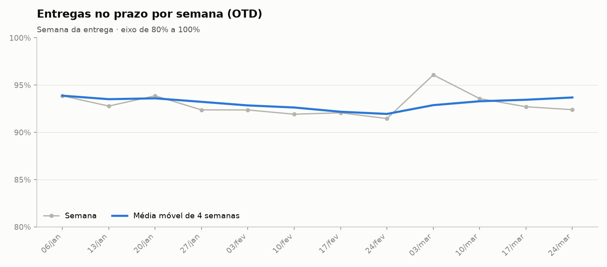
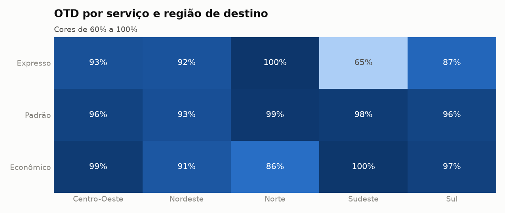
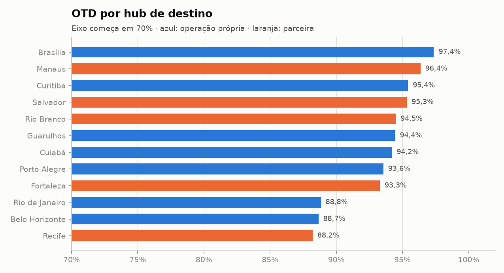
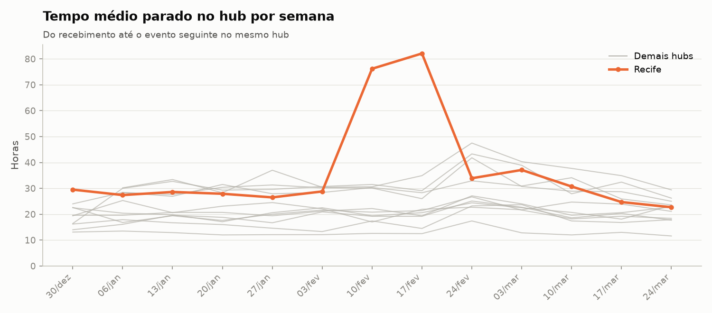
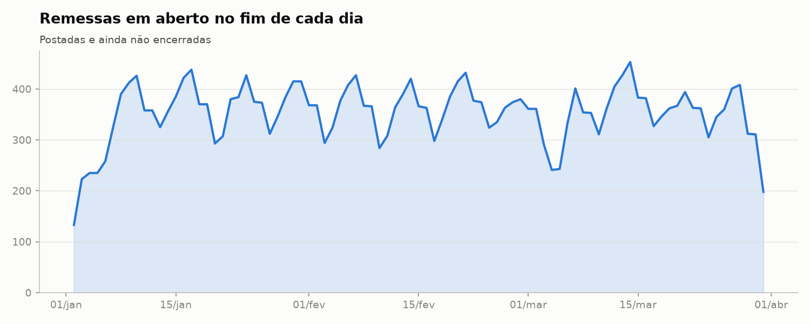
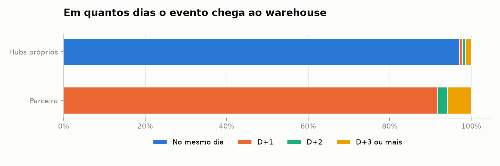

# Relatório de logística

_Gerado automaticamente por `python main.py`._

## 1. Indicadores

| indicador | valor |
|---|---|
| remessas | 7.682,00 |
| entregues | 7.416,00 |
| prazos_vencidos | 7.258,00 |
| no_prazo | 6.710,00 |
| otd_pct | 92,45 |
| em_transito | 198,00 |
| em_aberto_atrasadas | 27,00 |
| extraviadas | 48,00 |
| devolvidas | 20,00 |
| lead_time_medio_dias | 3,89 |
| pct_com_tentativa_falha | 12,71 |
| frete_total | 312.427,84 |

## 2. Prazo (OTD)

| ano_mes | prazos_vencidos | no_prazo | atrasadas | em_aberto_atrasadas | otd_pct | variacao_pp |
|---|---|---|---|---|---|---|
| 2025-01 | 2.388 | 2.196 | 181 | 11 | 91,96 |  |
| 2025-02 | 2.496 | 2.294 | 194 | 8 | 91,91 | -0,05 |
| 2025-03 | 2.374 | 2.220 | 146 | 8 | 93,51 | 1,61 |

| servico | regiao_destino | entregues | otd_pct | lead_time_medio_dias | prazo_medio_dias_uteis |
|---|---|---|---|---|---|
| economico | Norte | 104 | 85,58 | 9,26 | 7,20 |
| economico | Nordeste | 354 | 91,24 | 7,18 | 6,10 |
| economico | Sul | 336 | 96,73 | 4,39 | 4,90 |
| economico | Centro-Oeste | 205 | 98,54 | 5,16 | 5,20 |
| economico | Sudeste | 865 | 99,54 | 3,45 | 4,40 |
| expresso | Sudeste | 711 | 64,56 | 2,04 | 1,40 |
| expresso | Sul | 245 | 87,35 | 2,40 | 2,00 |
| expresso | Nordeste | 277 | 92,06 | 3,13 | 3,10 |
| expresso | Centro-Oeste | 150 | 92,67 | 2,42 | 2,20 |
| expresso | Norte | 82 | 100,00 | 3,42 | 4,10 |
| padrao | Nordeste | 839 | 93,09 | 5,70 | 5,10 |
| padrao | Sul | 769 | 95,84 | 3,70 | 4,00 |
| padrao | Centro-Oeste | 415 | 96,39 | 4,14 | 4,20 |
| padrao | Sudeste | 1.848 | 98,16 | 2,96 | 3,40 |
| padrao | Norte | 216 | 99,07 | 6,83 | 6,20 |

| hub_destino | cidade | regiao | operador | entregues | otd_pct | pct_tentativa_falha | pior_otd_geral | pior_otd_no_operador |
|---|---|---|---|---|---|---|---|---|
| REC | Recife | Nordeste | parceira | 475 | 88,21 | 21,26 | 1 | 1 |
| BHZ | Belo Horizonte | Sudeste | propria | 740 | 88,65 | 10,68 | 2 | 1 |
| RIO | Rio de Janeiro | Sudeste | propria | 1.012 | 88,83 | 9,88 | 3 | 2 |
| FOR | Fortaleza | Nordeste | parceira | 417 | 93,29 | 17,99 | 4 | 2 |
| POA | Porto Alegre | Sul | propria | 652 | 93,56 | 9,66 | 5 | 3 |
| CGB | Cuiabá | Centro-Oeste | propria | 276 | 94,20 | 6,88 | 6 | 4 |
| SAO | Guarulhos | Sudeste | propria | 1.672 | 94,44 | 10,35 | 7 | 5 |
| RBR | Rio Branco | Norte | parceira | 127 | 94,49 | 25,20 | 8 | 3 |
| SSA | Salvador | Nordeste | parceira | 578 | 95,33 | 22,66 | 9 | 4 |
| CWB | Curitiba | Sul | propria | 698 | 95,42 | 11,17 | 10 | 6 |
| MAO | Manaus | Norte | parceira | 275 | 96,36 | 16,73 | 11 | 5 |
| BSB | Brasília | Centro-Oeste | propria | 494 | 97,37 | 8,50 | 12 | 7 |

## 3. Gargalos

| hub_id | cidade | operador | passagens | horas_medias | horas_maximas | ranking_gargalo |
|---|---|---|---|---|---|---|
| REC | Recife | parceira | 617 | 36,70 | 164,50 | 1 |
| RBR | Rio Branco | parceira | 128 | 34,60 | 79,40 | 2 |
| FOR | Fortaleza | parceira | 500 | 31,40 | 81,60 | 3 |
| SSA | Salvador | parceira | 738 | 30,20 | 87,70 | 4 |
| MAO | Manaus | parceira | 354 | 29,30 | 83,90 | 5 |
| CGB | Cuiabá | propria | 431 | 22,50 | 62,90 | 6 |
| RIO | Rio de Janeiro | propria | 1.804 | 21,20 | 78,30 | 7 |
| POA | Porto Alegre | propria | 1.219 | 20,70 | 70,00 | 8 |
| BHZ | Belo Horizonte | propria | 1.433 | 20,20 | 87,10 | 9 |
| CWB | Curitiba | propria | 1.506 | 19,30 | 82,00 | 10 |
| BSB | Brasília | propria | 1.190 | 17,30 | 83,00 | 11 |
| SAO | Guarulhos | propria | 6.871 | 12,90 | 85,60 | 12 |

## 4. Lead time

| servico | regiao_origem | regiao_destino | entregues | media_dias | p50_dias | p90_dias |
|---|---|---|---|---|---|---|
| economico | Sul | Norte | 21 | 10,10 | 10,14 | 11,23 |
| economico | Nordeste | Nordeste | 21 | 7,17 | 9,09 | 11,22 |
| economico | Sudeste | Norte | 67 | 8,73 | 8,94 | 10,22 |
| economico | Sul | Nordeste | 70 | 8,18 | 8,05 | 9,90 |
| economico | Centro-Oeste | Nordeste | 23 | 8,40 | 8,19 | 9,71 |
| padrao | Nordeste | Nordeste | 40 | 6,39 | 7,08 | 8,87 |
| padrao | Sul | Norte | 45 | 7,54 | 7,21 | 8,85 |
| economico | Nordeste | Sudeste | 34 | 6,89 | 6,87 | 8,29 |
| economico | Sudeste | Nordeste | 236 | 6,67 | 6,26 | 8,17 |
| padrao | Nordeste | Sul | 39 | 6,28 | 6,09 | 8,13 |
| economico | Sul | Centro-Oeste | 33 | 6,48 | 6,14 | 7,94 |
| padrao | Sudeste | Norte | 145 | 6,49 | 6,27 | 7,36 |
| padrao | Centro-Oeste | Nordeste | 57 | 6,48 | 6,23 | 7,24 |
| padrao | Sul | Nordeste | 163 | 6,27 | 6,07 | 7,24 |
| padrao | Norte | Sudeste | 20 | 6,44 | 6,24 | 7,13 |

## 5. Backlog

### Remessas paradas

| remessa_id | servico | hub_origem | hub_destino | data_limite | situacao_sla | ultimo_evento | ultimo_hub | ultimo_evento_em | dias_sem_evento |
|---|---|---|---|---|---|---|---|---|---|
| BR0101208 | padrao | SAO | CWB | 2025-01-14 | em_aberto_atrasada | SAIU_ENTREGA | CWB | 2025-01-10 | 80 |
| BR0101414 | economico | SAO | SAO | 2025-01-15 | em_aberto_atrasada | SAIU_ENTREGA | SAO | 2025-01-10 | 80 |
| BR0100961 | economico | BHZ | POA | 2025-01-14 | em_aberto_atrasada | SAIU_ENTREGA | POA | 2025-01-11 | 79 |
| BR0101778 | economico | CGB | SAO | 2025-01-17 | em_aberto_atrasada | SAIU_ENTREGA | SAO | 2025-01-14 | 76 |
| BR0102114 | padrao | SAO | CWB | 2025-01-17 | em_aberto_atrasada | SAIU_ENTREGA | CWB | 2025-01-16 | 74 |
| BR0103129 | expresso | BHZ | CWB | 2025-01-21 | em_aberto_atrasada | SAIU_ENTREGA | CWB | 2025-01-20 | 70 |
| BR0102660 | padrao | SAO | CWB | 2025-01-21 | em_aberto_atrasada | TENTATIVA_FALHA | CWB | 2025-01-20 | 70 |
| BR0103192 | padrao | CGB | BHZ | 2025-01-23 | em_aberto_atrasada | SAIU_ENTREGA | BHZ | 2025-01-21 | 69 |
| BR0103346 | padrao | SAO | RIO | 2025-01-23 | em_aberto_atrasada | SAIU_ENTREGA | RIO | 2025-01-23 | 67 |
| BR0103896 | padrao | SAO | SAO | 2025-01-27 | em_aberto_atrasada | SAIU_ENTREGA | SAO | 2025-01-24 | 66 |
| BR0104631 | padrao | RIO | SAO | 2025-01-30 | em_aberto_atrasada | SAIU_ENTREGA | SAO | 2025-01-30 | 60 |
| BR0105144 | padrao | SAO | POA | 2025-02-04 | em_aberto_atrasada | SAIU_ENTREGA | POA | 2025-02-01 | 58 |
| BR0104971 | padrao | SAO | SSA | 2025-02-04 | em_aberto_atrasada | SAIU_ENTREGA | SSA | 2025-02-01 | 58 |
| BR0106613 | padrao | SAO | SAO | 2025-02-10 | em_aberto_atrasada | SAIU_ENTREGA | SAO | 2025-02-06 | 53 |
| BR0106631 | economico | SAO | FOR | 2025-02-13 | em_aberto_atrasada | SAIU_ENTREGA | FOR | 2025-02-10 | 49 |
| BR0107622 | expresso | POA | SAO | 2025-02-13 | em_aberto_atrasada | SAIU_ENTREGA | SAO | 2025-02-13 | 46 |
| BR0107987 | padrao | CWB | BHZ | 2025-02-19 | em_aberto_atrasada | SAIU_ENTREGA | BHZ | 2025-02-17 | 42 |
| BR0108428 | economico | BHZ | BHZ | 2025-02-21 | em_aberto_atrasada | SAIU_ENTREGA | BHZ | 2025-02-17 | 42 |
| BR0109905 | padrao | SAO | SAO | 2025-02-27 | em_aberto_atrasada | SAIU_ENTREGA | SAO | 2025-02-25 | 34 |
| BR0110210 | economico | SAO | SAO | 2025-03-06 | em_aberto_atrasada | SAIU_ENTREGA | SAO | 2025-02-27 | 32 |

## 6. Clientes com pior OTD

| cliente_id | nome | segmento | entregues | otd_pct | frete | ranking |
|---|---|---|---|---|---|---|
| C0128 | Loja Virtual 0128 | Eletrônicos | 44 | 81,82 | 1.826,15 | 1 |
| C0151 | Loja Virtual 0151 | Livros | 36 | 83,33 | 1.452,30 | 2 |
| C0088 | Loja Virtual 0088 | Livros | 44 | 86,36 | 1.734,94 | 3 |
| C0008 | Loja Virtual 0008 | Livros | 37 | 86,49 | 1.475,88 | 4 |
| C0117 | Loja Virtual 0117 | Eletrônicos | 52 | 86,54 | 2.168,69 | 5 |
| C0161 | Loja Virtual 0161 | Casa | 39 | 87,18 | 1.613,51 | 6 |
| C0035 | Loja Virtual 0035 | Moda | 40 | 87,50 | 1.663,80 | 7 |
| C0048 | Loja Virtual 0048 | Casa | 41 | 87,80 | 1.667,81 | 8 |
| C0064 | Loja Virtual 0064 | Livros | 35 | 88,57 | 1.440,22 | 9 |
| C0069 | Loja Virtual 0069 | Livros | 35 | 88,57 | 1.398,66 | 9 |
| C0055 | Loja Virtual 0055 | Casa | 131 | 89,31 | 5.439,29 | 10 |
| C0145 | Loja Virtual 0145 | Moda | 57 | 89,47 | 2.222,51 | 11 |
| C0109 | Loja Virtual 0109 | Livros | 105 | 89,52 | 4.183,49 | 12 |
| C0120 | Loja Virtual 0120 | Moda | 86 | 89,53 | 3.531,38 | 13 |
| C0057 | Loja Virtual 0057 | Eletrônicos | 62 | 90,32 | 2.473,70 | 14 |

## 7. Saúde da carga

| lotes | primeiro | ultimo | remessas_lidas | eventos_lidos | eventos_novos | duplicados_ignorados | rejeitados |
|---|---|---|---|---|---|---|---|
| 89 | 2025-01-02 | 2025-03-31 | 7.830 | 59.535 | 58.665 | 870 | 230 |

### Latência dos dados

| fonte | dias_de_atraso | eventos | pct_da_fonte |
|---|---|---|---|
| parceiro | 1 | 7.825 | 91,76 |
| parceiro | 2 | 203 | 2,38 |
| parceiro | 3 | 154 | 1,81 |
| parceiro | 4 | 158 | 1,85 |
| parceiro | 5 | 187 | 2,19 |
| parceiro | 6 | 1 | 0,01 |
| proprio | 0 | 48.655 | 97,04 |
| proprio | 1 | 413 | 0,82 |
| proprio | 2 | 366 | 0,73 |
| proprio | 3 | 363 | 0,72 |
| proprio | 4 | 340 | 0,68 |

### Quarentena

| fonte | motivo | registros |
|---|---|---|
| proprio | hub_desconhecido | 113 |
| proprio | relogio_invalido | 91 |
| parceiro | hub_desconhecido | 25 |

### Testes de qualidade

| teste | severidade | falhas | passou |
|---|---|---|---|
| entrega_antes_da_postagem | critica | 0 | sim |
| evento_repetido | critica | 0 | sim |
| lacuna_de_lotes | critica | 0 | sim |
| limite_em_dia_nao_util | critica | 0 | sim |
| remessa_sem_fato | critica | 0 | sim |
| situacao_incoerente | critica | 0 | sim |
| evento_depois_da_entrega | alerta | 0 | sim |
| eventos_orfaos | alerta | 0 | sim |
| peso_invalido | alerta | 18 | não |
| registros_em_quarentena | alerta | 229 | não |
| saiu_para_entrega_sem_desfecho | alerta | 28 | não |

### Comparação com o gabarito

| verificacao | remessas |
|---|---|
| Remessas no gabarito | 7.682 |
| Remessas no warehouse | 7.682 |
| Data limite correta | 7.682 |
| Status igual ao real | 7.599 |
| Status divergente: evento final em quarentena | 27 |
| Status divergente: evento final ainda não chegou no corte | 56 |
| Entregas com data local correta | 7.416 |
| Entregas conferidas | 7.416 |
| Entregas com situação de prazo correta | 7.416 |
